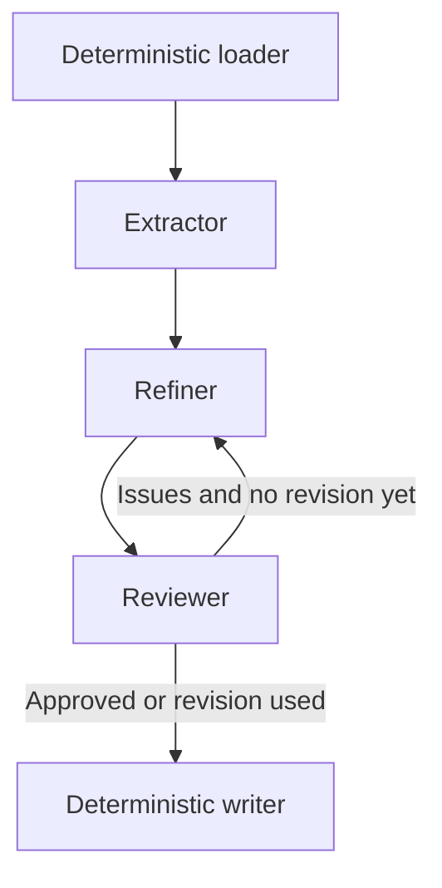

# Requirements network — design and execution report

The implementation follows `Task_1.md`. There was no existing Task 1 implementation
or dependency file to reuse. The inspected repository snapshot is
`19a5cd3a29c0bc3a87f5656af0dd5864f49e329d`. The supplied corpus contains **20 files** (8 TXT and
12 EML), **145,535 decoded characters**, including nested email conversations.

## Graph and responsibilities



- **Loader:** recursively reads complete UTF-8 `.txt`, `.md`, and `.eml` files.
  Relative paths become stable source IDs. Emails retain their complete headers,
  bodies and quoted threads. Unsupported, empty or unreadable files are reported
  to stderr and, after a completed run, in the document and audit.
- **Extractor — `gpt-4.1-nano`:** extracts source-linked candidates in document
  batches; acknowledges every document. Python assigns unique candidate IDs.
- **Refiner — `gpt-4o-mini`:** merges duplicates, preserves candidate lineage and
  source unions, assigns final IDs and priorities, standardizes explanations,
  and records justified discards and unresolved conflicts.
- **Reviewer — `gpt-5-nano`:** uses minimal reasoning effort for speed and checks OS1–OS9 against the entire raw corpus,
  extracted candidates, final draft and priority scale; returns actionable issues.
- **Writer:** renders one Markdown requirements document with priorities,
  sources, requirements, blacklist and remaining issues. A separate `.audit.json`
  records actual model calls, usage, reviews, draft and node trace.

`State` passes documents, file issues, candidates, draft, current/all reviews,
refinement count, API call records, node trace and output path. Nodes return
partial state updates. The refiner also receives the complete raw corpus on both
passes, so it can recover missed requirements identified by the reviewer.

`review_route` returns to the refiner if any review check fails or an issue is
reported and fewer than two refinement passes have run. Revision is followed by
a final review. Any remaining issues are written explicitly; there is no third
refinement. Model review is a quality judgment, not a guarantee of correctness.

## Compliance mapping

All code references below are symbols in `requirements_network.py`. Prompt
excerpts are literal text sent to models, not only documentation or comments.

| Spec | Code / node | Prompt instruction or implementation |
|---|---|---|
| ANS1 | `extractor`, `refiner`, `reviewer`, `ask` | Three distinct nodes call `client.chat.completions.create`. |
| ANS2 | `loader`, `writer` | Python file loading, validation and rendering; no LLM. |
| ANS3 | `review_route`, `Network.graph` | Reviewer evaluates the refiner; conditional edge can return to refiner once. |
| ANS4 | `MODELS`, `main` | Three distinct models from the assignment list; configuration validated. |
| ANS5 | `State`, `Network.graph` | Python `StateGraph`, conditional edges, `compile`, `invoke`. |
| OS1 | `REFINE_PROMPT`, `REVIEW_PROMPT`, `writer` | “OS1: Produce content for ONE structured requirements document” |
| OS2 | `REFINE_PROMPT`, `validate_draft` | “OS2: Assign each final requirement a unique ID REQ-001, REQ-002, etc.” |
| OS3 | `REFINE_PROMPT`, `validate_draft` | “OS3: Detect and merge semantic duplicates; preserve the union of their sources and candidate_ids.” |
| OS4 | `EXTRACT_PROMPT`, `REFINE_PROMPT`, `check_sources` | “OS4: Trace every candidate to the exact supplied source document ID(s); never invent sources.” |
| OS5 | `REFINE_PROMPT`, `Requirement` | “OS5: Give every final requirement a short descriptive name and a paragraph-long explanation” |
| OS6 | `REFINE_PROMPT`, `PRIORITIES`, `writer` | “OS6: Assign High, Medium or Low priority using the provided priority_scale.” Writer explains that scale. |
| OS7 | `REFINE_PROMPT`, `REVIEW_PROMPT` | “OS7: Use consistent English and terminology. Resolve conflicts only when supported by source decisions, scope or chronology” |
| OS8 | `EXTRACT_PROMPT`, `REFINE_PROMPT`, `validate_draft` | “OS8: Read ALL provided documents in FULL”; “every candidate ID must occur in a final requirement or blacklist.” |
| OS9 | `REFINE_PROMPT`, `Discarded`, `writer` | “OS9: Put requirements discarded as conflicting or nonsensical in a separate blacklist” with sources, lineage and reasons. |

`REVIEW_PROMPT` explicitly enumerates **every OS1–OS9** again and requires exactly
nine pass/fail checks. Structural validation rejects malformed schemas, invented
source IDs, duplicate final IDs, lost candidate IDs or lost source unions. It
cannot determine whether a cited source actually supports a claim or whether two
requirements are semantically equivalent; those checks belong to the LLM review.

## Bounds and speed tradeoffs

Defaults batch up to 180,000 serialized characters, so the supplied corpus fits
in one extraction call. Normal execution uses **3 API calls**, or **5** when the
single feedback revision is used. Larger supported corpora can use more extraction
batches. No calls are made per requirement.

Each request is limited to 350,000 characters, each generation to 14,000 completion
tokens, each review to 3,000, and each HTTP attempt to 120 seconds. The OpenAI SDK
has `max_retries=1` (at most two attempts per logical call). Graph recursion is
limited to 10 steps. Invalid JSON/schema, refusal or truncated output fails
immediately; no repair-call loop or fabricated fallback is used. A full request
that exceeds the character guard fails without truncation. Character limits are
only a conservative size guard, not a model tokenizer or a promise that every
larger corpus fits the model context. Raising `--batch-chars` cannot remove the
full-corpus context limit at refinement/review.

Small models, JSON mode plus basic Pydantic validation, batched extraction and a
single revision prioritize execution time over polished extraction. Full source
context costs input tokens but allows meaningful coverage review. Output caps may
cause a dense corpus to fail rather than silently lose requirements. No latency,
cost, or semantic-quality claims have been measured in a live model run.

## Setup and run

From `Week_04_Requirements/Task_1`, using Python 3.10 or later:

```bash
python -m venv .venv
source .venv/bin/activate
python -m pip install -r requirements.txt
read -rsp 'OpenAI API key: ' OPENAI_API_KEY
export OPENAI_API_KEY
printf '\n'
python requirements_network.py data/corpus --output requirements.md
```

The key is read only from the environment and is never logged. For a different
corpus, replace `data/corpus` with the input directory. Supported formats are
plain UTF-8 text/Markdown and text-format email; binary/PDF/Word and encoded MIME
attachments are not decoded by this minimal loader. Other files are reported.

```bash
python requirements_network.py data/corpus --inspect
python -m unittest discover -s tests -v
```

Exit codes: **0** completed with no reported issues (or successful inspection),
**1** execution/configuration/validation failure, **2** document written but
review, source-loading or draft issues remain. An existing output is not removed
on a failed rerun; check the exit code and audit rather than treating an old file
as a fresh result.

## Observed verification and deliverable status

Installed environment: OpenAI 3.36.1, LangGraph 1.2.16, Pydantic 2.14.0.
Inspection succeeded: 20 documents, 145,535 characters, no skipped/unreadable files.

**All 12 structural tests passed** (`Ran 12 tests in 10.014s`, `OK`).

The unittest suite uses explicitly synthetic API fixtures and the real LangGraph
runtime and corpus. It checks both routing paths, final rejection termination,
three distinct requested model IDs, complete source state, feedback state,
batching, lineage/source validation, JSON/length failures, API failure handling,
missing credentials, prompt coverage and document/audit writing. Fixture outputs
are temporary and are deleted; they are not corpus-generated deliverables.

The live command was attempted and exited **1** with:
`ERROR: Missing OPENAI_API_KEY. Set it in your environment and rerun.`
Consequently **no live model was invoked and no genuine `requirements.md` or
`.audit.json` was generated**. The required corpus-generated document remains
blocked on credentials. Run the setup/run command above to create it; model
availability, live execution latency and semantic quality remain unverified.
