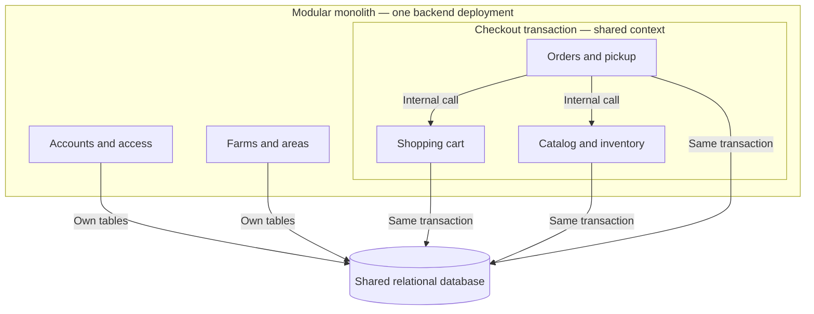

# ADR-001: Use a modular monolith on managed hosting for NFFH

- **System:** Not Far(m) From Home (NFFH)
- **Date:** 29 October 2026
- **Status:** Proposed
- **Scope:** Initial application architecture and checkout consistency
- **Source:** Task 1 architecture discussion, recorded in `NFFH_Architecture_Notes(1).md`, sections 1–6.

## Context

NFFH connects consumers with local farms. Farmers publish products, prices, and available quantities. Customers discover farms and products, maintain a cart, and reserve products for pickup at a farm. Administrators manage users and business data.

The discussion identified five logical responsibilities: Accounts and access; Farms and areas; Catalog and inventory; Shopping cart; and Orders and pickup. These responsibilities need clear boundaries, but do not inherently require separate services.

The central consistency concern is checkout: an order and its stock reservation must agree, including when customers compete for the last available quantity or retry after losing a response. Under the proposed all-or-nothing policy, insufficient stock for any cart item must leave no confirmed order and no committed stock reduction.

Traffic, budget, team size, availability targets, and performance targets are unspecified. The discussion established no measured need for independent deployment or scaling. Online payments, delivery, notifications, and pickup-capacity scheduling are outside the explicitly documented scope summarized in the notes.

## Decision drivers

- Keep order creation and stock reservation consistent under concurrency and retries.
- Limit implementation, testing, debugging, and operational complexity.
- Preserve business boundaries so individual capabilities can evolve.
- Reduce infrastructure maintenance through managed hosting and a managed relational database.
- Avoid distributed recovery workflows unless a concrete requirement justifies them.

## Decision

Adopt a **modular monolith deployed on managed hosting, using one relational application database**, as the proposed initial architecture.

One backend deployment will contain the five business modules identified above. Modules communicate through explicit internal interfaces and modify only their own tables. Administration reuses the relevant modules’ rules. Multiple application instances may run when needed without changing this decomposition.

Orders owns checkout coordination; Inventory owns stock validation and reservation rules. Checkout uses one database transaction shared by Cart, Inventory, and Orders through a common transaction context. Inner modules must not commit independently or open unrelated transactions for this workflow.

Hosting and logical decomposition are separate decisions. Managed authentication is compatible with this architecture, but the provider, framework, database product, and authentication implementation remain undecided. This ADR does not select a serverless function execution model.

### Architecture overview

The inner boundary groups operations participating in checkout, not every operation of those modules. Orders coordinates Cart and Inventory through internal calls; checkout database work uses the same transaction-bound connection/session and commits or rolls back together. All five modules use the shared database while retaining ownership of their tables.

### Required implementation properties

1. **Atomic checkout:** stock changes and order writes commit together. If any item is unavailable, the transaction rolls back before a failure response is returned.
2. **Concurrency control:** use row locks or conditional stock updates and check their results. Availability reads alone are insufficient. Acquire multiple inventory locks in a consistent order to reduce deadlocks.
3. **Idempotent retries:** persist a checkout key scoped to the customer, enforce uniqueness, and associate it with the request contents and order result. The key record, order result, and stock changes must commit in the same database transaction. If commit succeeds but the response is lost, a retry with the same key and contents returns the saved order result without creating another order or reserving stock again. If the transaction rolls back, none of these changes is committed. The uniqueness constraint also prevents simultaneous requests with the same key from committing duplicate orders. Reuse of a key with changed contents is rejected.
4. **Authoritative records:** compute totals on the backend and store relevant product, price, and unit snapshots on order lines. Product removal must preserve order history.
5. **Backend authorization:** verify identity, permissions, and product-to-farm ownership through application rules. A farmer role alone does not authorize editing every product.
6. **Bounded database use:** configure connection pools against the total database capacity across all application instances; keep transactions short and use appropriate acquisition, lock, and transaction timeouts.

## Alternatives considered

| Alternative | Main benefit | Main trade-off | Outcome |
| --- | --- | --- | --- |
| Modular monolith on managed hosting | Atomic checkout and fewer operational components, with clear internal boundaries | Shared deployment, scaling, and application failure scope | Proposed choice |
| Independent services with separate databases | Independent team ownership, deployment, scaling, and potential failure isolation | Checkout requires local transactions plus durable coordination, idempotency, reservation expiry, and reconciliation | Defer until justified by concrete requirements |
| Managed authentication, backend functions, and one managed relational database | Managed function execution and infrastructure | Connection pressure, startup latency, execution limits, provider dependence, and platform-specific tooling | Viable alternative; no demonstrated advantage for the present requirements |

With independent services, Inventory could reserve stock while Ordering crashes before saving the order. A reservation saga would need durable checkout attempts, stable reservation IDs, temporary holds, confirmation, expiry, and recovery workers. A timeout would represent uncertainty rather than definite failure. These mechanisms add substantial complexity without an established need for service independence.

The serverless alternative can preserve atomic checkout if one function or transactional database routine performs all stock and order writes in one transaction. Separate function calls do not automatically share a transaction. Function scaling also needs backpressure: a pool or proxy cannot create unlimited database throughput. The discussion did not establish cost or performance evidence favoring this option.

## Consequences

### Positive

- Checkout can use ordinary database transactions instead of cross-service recovery.
- Fewer network boundaries simplify development, testing, debugging, and operation.
- Managed infrastructure reduces infrastructure maintenance, while business rules remain under application control.
- Explicit module interfaces provide boundaries for later extraction if requirements change.

### Negative and obligations

- Modules share a release cycle and application scaling; an application failure may affect several capabilities.
- Shared database access requires discipline to prevent modules from bypassing one another’s rules.
- The database remains a shared capacity and availability dependency. Connection limits and workload contention still require monitoring and configuration.
- Managed infrastructure introduces provider dependence and does not remove responsibility for schema design, authorization, backup retention, or recovery configuration.
- Extracting a module later will require API and data-ownership changes. Separating Inventory from Ordering will require revisiting checkout consistency.

## Assumptions and open questions

The design follows the discussion’s proposed baseline: cart additions do not reserve stock; successful checkout does; checkout is all-or-nothing; and order history survives product removal. These are proposed policies rather than independently verified requirements.

One farm per cart was suggested but remains unconfirmed. Inventory units and precision, valid pickup dates and timezones, seasonal-product rules, cancellation and fulfillment behavior, and user-deletion semantics also remain unresolved. These policies must be clarified before their related behavior is implemented; they do not currently establish a need for independent services.

The notes’ live Accounts check for farmer writes was discussed for the independent-services option. The chosen monolith still needs an explicit account-suspension policy, but does not require that separate network call.

## Revisit this decision when

- Several teams demonstrably need independent releases and operation.
- Inventory must serve multiple sales channels or external partners as an independent authority.
- Measurements show a capability needs materially different scaling after simpler optimizations are assessed.
- Explicit failure-isolation, security, or infrastructure requirements demand separate deployment boundaries.
- Platform experience, workload measurements, and operational or cost evidence establish a clear benefit for serverless execution.

Reconsider only the boundaries affected by the new requirement. For example, catalog browsing could be extracted while order creation and stock reservation remain in one transaction.

## Decision status and evidence limits

This ADR formalizes the discussion’s provisional recommendation. It does not claim final stakeholder acceptance, an implemented system, or completed performance, availability, or cost validation. Acceptance and subsequent architectural changes should be recorded explicitly.
