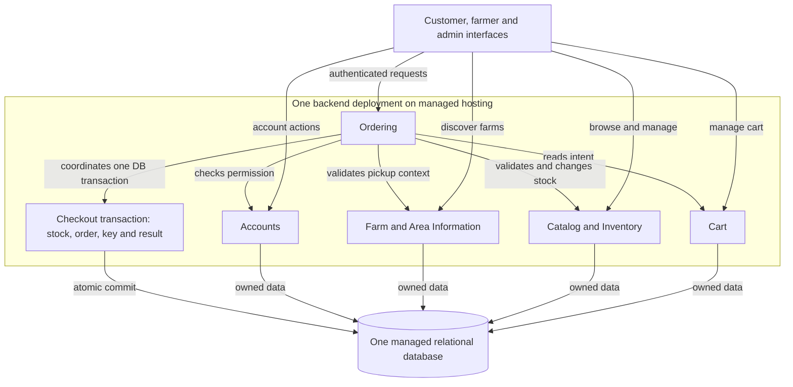

# ADR-001: Modular monolith on managed hosting for the initial NFFH application

- **Date:** 1 November 2026
- **Status:** Proposed
- **Acceptance evidence:** Final acceptance is not established. The discussion retained a provisional recommendation and marked Task 1 complete at architecture-selection level.
- **Implementation and validation:** Not established; this record describes intended behavior, not a tested implementation.

## Context and evidence

Not Far(m) From Home (NFFH) connects customers with agricultural companies. The discussion reports requirements for registration and access, farm/product discovery, carts and pickup orders, farmer product and stock management, and administration. Checkout must coordinate order creation and stock changes under concurrent requests and retries.

### Source provenance

The primary source is the later `NFFH_Architecture_Discussion (1).md` (1 November 2026), which supplies the one-team assumption, suspension discussion, fuller function-capacity comparison, provisional recommendation and reconsideration triggers; ledger section references refer to this source. The original `NFFH_Architecture_Discussion_Notes1_after_skill.md` stops before the checkout-policy answer, whereas its longer `(4)` copy continues through checkout idempotency and service-reservation recovery, but still contains no final recommendation. These are discussion summaries, not full transcripts; the original requirements were not independently verified here, and no final acceptance or operational measurements are established.

### Compact evidence ledger

| ID | Statement and classification | Source section | Decision impact |
|---|---|---|---|
| E1 | Reported requirements: accounts, discovery, ordering, farmer product/stock management and administration | 2 | Defines logical responsibilities; does not require separate deployments |
| E2 | User-proposed working policy: fail the whole checkout when an item is unavailable; restore any stock held by a failed attempt | 3 | Favors atomic checkout; remains a policy to confirm |
| E3 | User-proposed working assumption: one small team initially deploys together | 3, 12 | Supports one deployment; not a verified project constraint |
| E4 | Proposed mechanism: successful checkout reserves stock; precise lifecycle remains open | 3, 6–7 | Requires guarded stock writes and retry identity |
| E5 | Proposed suspension policy; strict timing and outage behavior remain unresolved | 3, 9 | Requires explicit authorization semantics |
| E6 | Open evidence gaps: workload, availability, budget, platform skills and operational comparisons | 10–14 | Keeps hosting choice and recommendation provisional |
| E7 | Recommendation: modular monolith on managed hosting with one managed relational database; no final acceptance | 12–14 | Recorded here as Proposed |

Payments, delivery, notifications and pickup-capacity limits are not reported as stated requirements. This does not prohibit future additions. Neither a one-farm-per-cart restriction nor multi-farm cart support was agreed.

## Decision drivers

1. Preserve consistent stock and order outcomes under the proposed all-or-nothing checkout policy.
2. Recover a committed result after a lost response without repeating stock changes for the same checkout identity.
3. Keep delivery and operations proportionate to the assumed single team.
4. Maintain clear ownership and authorization boundaries while allowing later changes where evidence warrants them.

No numeric availability, latency, throughput or cost targets have been established.

## Proposed decision

Build the initial backend as one modular application, deployed on managed application hosting, with one managed relational database. Use in-process module interfaces and enforce ownership of writes. Shared storage does not authorize arbitrary cross-module access.

| Logical module | Responsibility and authoritative business data |
|---|---|
| Accounts | Identity integration, account/profile lifecycle, roles and account status |
| Farm and Area Information | Farm/company details and area information; pickup-related farm information |
| Catalog and Inventory | Products, prices, ownership and available stock |
| Cart | Intended products and quantities; checkout inputs |
| Ordering | Checkout coordination, order history, historical order lines and durable checkout identity/result |

These five modules are a proposed grouping of the discussed responsibilities, not five services. Administration uses their interfaces and authorization rules rather than maintaining duplicate business data. Discovery reads the relevant farm, area and catalog information. Authentication technology and hosting provider remain undecided.

### Why this is provisionally preferred

The assumed single team gains no established benefit from independent capability deployments, while the proposed checkout policy fits one local transaction. This permits stock, the order and its retry result to commit together without cross-service recovery. Managed hosting can address infrastructure responsibilities without requiring function execution. Functions remain viable, but no additional cost, operational or delivery advantage has been demonstrated.

Missing operational evidence prevents a final platform choice. It does not remove the supported structural advantage of a local transaction for this workflow. This recommendation should be validated against actual team and operating constraints before acceptance.

### Architecture overview

The boxes inside the application are logical boundaries. The transaction node shows the checkout operation, not a separate component or a transaction encompassing every module operation. Ordering also reads/writes its owned order data in this database. Every participating checkout write must use the same database transaction context; ordinary module arrows do not imply independent commits.

### Checkout and retry guarantees

Ordering coordinates checkout. Every request first authenticates the customer and authorizes access to that customer's checkout attempt and result. The retry path then compares the incoming immutable request fingerprint with the stored fingerprint for `(customer_id, checkout_key)`.

If a committed result already exists and the fingerprints match, return that durable result or order reference **before revalidating mutable cart, price or stock state**. A changed or cleared cart, changed price, or stock consumed by the original checkout must not make a successful same-key retry fail checkout validation. A fingerprint mismatch is a conflict; do not return a result for different contents or execute another checkout. Derive the fingerprint from the original immutable request representation, not by reconstructing it from the current cart.

Only a newly claimed attempt executes checkout validation and stock changes. Within one explicit database transaction:

1. Claim the stable customer-scoped checkout key, protected by a database unique constraint on `(customer_id, checkout_key)`, and record its immutable request fingerprint. An earlier result lookup is only an optimization; the unique constraint arbitrates concurrent claims.
2. For the successfully claimed new attempt, validate the products, quantities, accepted prices and pickup selection under the agreed policies. Enforce stock availability through conditional updates with checked affected-row counts, or suitable locking. A separate earlier availability read is insufficient.
3. Save the order and historical lines, preserving agreed descriptions, quantities and prices.
4. Save a durable result or order reference with the key and fingerprint, then commit the key, fingerprint, stock effects, order/lines and result/reference together.

No participating module commits independently. Any item failure or order-write failure rolls back the whole transaction under the proposed policy. A crash before commit leaves no committed partial stock/order effect; the database releases uncommitted work once connection loss or timeout is detected. Locks may remain until then.

If a concurrent request wins the unique-key claim, the losing request must not proceed to checkout validation or stock changes. After the winner commits, the loser reads the committed fingerprint and result using a fresh statement or transaction as required by database conflict handling, checks the fingerprint, and returns the existing result on a match. If the winner rolls back, its key claim and stock effects disappear, allowing another request to claim the attempt and execute checkout. A waiting timeout leaves the outcome uncertain: retry or query with the same key.

A crash or lost response after commit leaves the complete result durable. Recovery follows the authenticated, authorized fingerprint-check/result-return path above, without repeating mutable checkout validation or stock changes.

This prevents repeated committed effects for the same retained key. It does not deduplicate different keys or promise exactly-once network delivery. Retention, immutable request contents and cross-key duplicate policy require specification. The cart snapshot/version and concurrent cart-edit behavior must also be defined so a retry can identify the original intent.

Authorization uses the authenticated identity and authoritative ownership/status checks, not a browser-supplied owner ID. Checks must remain valid when a protected write executes. The proposed suspension policy still needs precise timing semantics; a token or preceding status check alone does not establish that no write can commit after suspension.

## Alternatives considered

| Option | Checkout mechanism | Advantages | Costs and disposition |
|---|---|---|---|
| Modular monolith on managed hosting | One explicit transaction for stock, order, key and result | Direct atomicity; fits assumed coordinated deployment | Shared release, process and database capacity; provisionally preferred |
| Independent services with separately owned databases | Ordering persists pending attempts; Inventory owns idempotent reservations; worker queries/retries stable operation IDs | Independent deployment/scaling and potential isolation | Independent commits require recovery and reconciliation; full confirmation/release/expiry protocol unresolved; deferred until autonomy or isolation is justified |
| Managed authentication, backend functions and one managed relational database | One invocation owns the complete checkout transaction; durable key/result handles retries | Provider manages invocation lifecycle; integrations may reduce effort | Execution limits, aggregate connections and provider dependence; no demonstrated advantage over managed application hosting; viable but deferred |

Separate service databases replace one atomic checkout commit with independent commits, durable pending outcomes and recovery owned by Ordering. Stable operation identities and idempotent Inventory effects are required; timeouts remain uncertain outcomes. The full confirmation/release/expiry protocol must be designed before a service split can preserve the proposed business outcome.

Decomposition and execution model are separate choices: managed infrastructure can host a monolith or services. Function scaling must remain bounded by database capacity; pooling reuses connections but does not increase database throughput. Asynchronous acceptance would also require durable work and result retrieval.

## Consequences

Expected benefits are simpler checkout consistency, fewer cross-process failure cases and a deployment model aligned with the working team assumption. These are qualitative design expectations, not measured delivery or cost improvements.

The backend releases together. Process failures and shared database pressure can affect several capabilities. The team remains responsible for module discipline, bounded connections/concurrency, authorization, monitoring, migrations, backups and tested recovery. Managed hosting does not remove these application responsibilities.

Use narrow interfaces and explicit write ownership to preserve an evolution path. Investigate actual bottlenecks and narrower changes before extracting services. There is no commitment to a later wholesale migration.

## Assumptions and open questions

The all-or-nothing checkout policy, single-team deployment assumption, stock-reservation model and suspension policy retain their classifications in E2–E5. This ADR does not convert them into accepted requirements.

### Questions that could change architecture acceptance

- Does the one-small-team/coordinated-release assumption hold, or do team autonomy and delivery constraints justify separate deployments?
- What workload, latency/availability targets, security/isolation constraints, budget and operational capabilities must the architecture satisfy? Could these invalidate shared process/database boundaries?
- Does provider-fit and total-cost/effort evidence support managed application hosting, or establish a concrete advantage for managed functions?
- Confirm the all-or-nothing policy and the consistency/authorization guarantees the business needs. Materially different guarantees or strict suspension timing across external boundaries could change the design.

These answers inform explicit architecture acceptance and provider selection. Missing evidence keeps this record Proposed.

### Details to resolve before implementing checkout

- Define cart scope, order grouping and pickup representation; no one-farm restriction is assumed. These affect the current data model and transaction without inherently requiring separate services.
- Define stock lifecycle, cancellations, pickup-date validation, price-change acceptance and historical deletion/archive behavior.
- Define immutable checkout contents, fingerprint canonicalization, cart snapshot/version and concurrent edits, key retention and duplicate handling across different keys. Ensure retries can submit the original identity independently of mutable cart state.
- Specify customer authorization for result retrieval and suspension effective timing, freshness and concurrency with protected writes under the chosen guarantees.
- Verify transaction propagation, database isolation/locking and uniqueness behavior, including concurrent checkouts, rollback, lost responses, fingerprint conflicts and same-key result replay after mutable state changes. No such runtime validation has been performed here.

Resolve these before relying on checkout behavior. If a detail exposes a new requirement for isolation, coordination or scale, return it to architecture review rather than assuming it is merely local implementation work.

### Questions only if service databases are separated

- Finalize mutually exclusive confirmation, release and expiry transitions, including release after confirmation and stale recovery actions.
- Define pending customer experience, reconciliation and eventual all-or-nothing outcomes across independent commits.
- Resolve cross-service authorization freshness and outage trade-offs if Accounts becomes independent. The later discussion proposed temporary rejection when current status cannot be established; this outage policy was not independently accepted.

## Reconsideration conditions

Review the relevant boundary if separate teams are repeatedly blocked by coordinated releases, measured workloads need independent scaling, or security/availability requirements demand deployment isolation. Reconsider managed functions if evidence shows lower total cost, operational effort or delivery time for the actual workload and team.

More users alone does not justify a service split. Evaluate the pressured capability and a limited change first. Final acceptance of this ADR remains a separate explicit decision.
